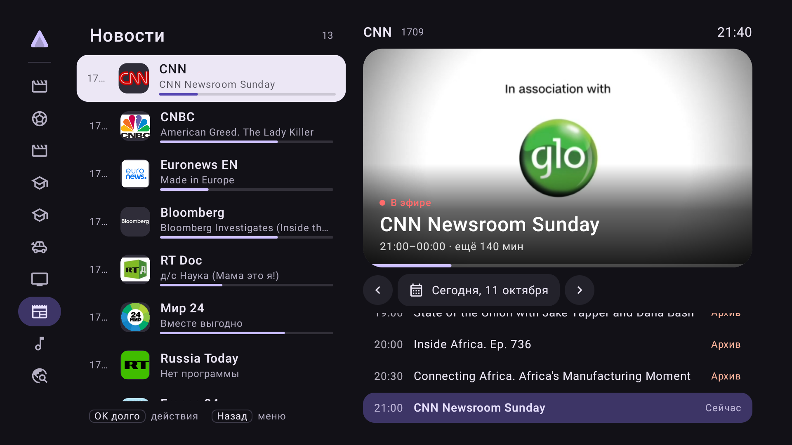

<p align="center">
  
</p>

<h1 align="center">Airloom</h1>

<p align="center">
  Клиент IPTV.ONLINE для Android TV: эфир, архив и телепрограмма под управлением пульта.
</p>

<p align="center">
  <a href="https://github.com/h1royuki/Airloom/releases/latest"></a>
  <a href="https://github.com/h1royuki/Airloom/actions/workflows/check.yml"></a>
  <a href="LICENSE"></a>
</p>



Airloom — нативное приложение на Compose for TV и Media3, рассчитанное на недорогие телевизоры с Android 11. Это личный проект, а не официальный клиент сервиса: в приложении нет каналов и встроенных учётных данных, для работы нужен собственный ключ IPTV.ONLINE.

## Возможности

- **Экран «Каналы».** Рейка разделов (избранное, последние, все каналы, категории), список каналов с текущей передачей и её прогрессом, кадр канала и программа на выбранный день.
- **Архив.** Прошедшие передачи открываются прямо из телепрограммы и из поиска; глубина архива берётся из плейлиста.
- **Плеер.** Карточка каналов поверх видео, перемотка архива, подсказка о следующей передаче, автоматическое восстановление при сбоях сети и три профиля буферизации.
- **Поиск.** По названиям каналов и по телепрограмме — идущие сейчас и архивные передачи; текстовый и голосовой ввод.
- **Свои списки.** Избранное, скрытие, закрепление и порядок каналов и категорий; настройки сохраняются при обновлении плейлиста.
- **Телепрограмма.** Полный или облегчённый EPG (`.xml`, `.xml.gz`), автообновление плейлиста и EPG по расписанию.
- **Оформление.** Светлая и тёмная темы, четыре акцентных цвета, размер текста и плотность списка.
- **Только пульт.** Вся навигация рассчитана на D-pad; запуск приложения не начинает воспроизведение и не включает звук.

## Требования

- Телевизор или приставка с Android TV 8.0 (API 26) и новее; приложение проверяется на Android 11. Root не нужен.
- Подписка IPTV.ONLINE и ключ доступа.

## Установка

Скачайте APK со страницы [релизов](https://github.com/h1royuki/Airloom/releases/latest) и установите его через ADB — на телевизоре должна быть включена отладка по сети:

```sh
adb connect TV_IP:5555
adb -s TV_IP:5555 install -r airloom-0.4.8.apk
```

APK универсальный: подходит и для 32-битных, и для 64-битных устройств.

## Сборка из исходников

Нужны JDK 21 и Android SDK 35.

```sh
export JAVA_HOME=/path/to/jdk-21
export ANDROID_HOME=/path/to/android-sdk

./scripts/sign-release.sh        # release APK в artifacts/airloom-release.apk
```

При первом запуске `sign-release.sh` создаёт постоянный ключ подписи в `~/.local/share/airloom/signing`. Сохраните его резервную копию: Android обновляет приложение без потери данных только APK с той же подписью. По той же причине собственную сборку нельзя поставить поверх APK из релизов, и наоборот.

Проверки, эмулятор и остальные команды описаны в [docs/BUILD.md](docs/BUILD.md) (на английском).

## Первый запуск

1. Выберите домен — `iptv.online`, `iptv.me` или свой — и введите ключ доступа либо полную ссылку на плейлист. Кнопка «Вставить» в поле берёт текст из буфера обмена телевизора.
2. Дождитесь проверки и импорта каналов.
3. Выберите полный или облегчённый EPG; этот шаг можно пропустить.
4. Настройте размер текста и плотность списка.

## Управление

| Где | Действие |
|---|---|
| Список каналов | OK — смотреть, удержание OK — избранное, закрепление, порядок, скрытие |
| Список каналов | ← — разделы; «Назад» — поиск и настройки в шапке рейки |
| Телепрограмма | ↑/↓ — передачи, OK — архив с начала; стрелки у даты и календарь — другой день |
| Плеер | OK — кнопки управления, ↑/↓ — карточка каналов, CH+/CH− — следующий и предыдущий канал |
| Плеер | Цифры — канал по номеру (OK — открыть сразу, «Назад» — отменить); Play, Pause и Stop на пульте |
| Плеер, кнопки | «С начала» — текущая передача из архива; «Звук» — выбор дорожки, если их несколько |
| Плеер, архив | ←/→ — перемотка на 10 секунд; кнопки перемотки на пульте — на 30 секунд |
| Карточка каналов в плеере | ← — разделы, удержание OK — избранное и скрытие |
| Выход | «Назад» дважды в течение двух секунд |

## Ограничения

- Один профиль одного провайдера; произвольные M3U и XMLTV не подключаются.
- Набор кодеков определяется телевизором.
- Записи, локального таймшифта, видеотеки и входа через Xtream нет.
- Доступность архива зависит от провайдера: приложение показывает то, что заявлено в плейлисте.

## Устройство проекта

| Модуль | Назначение |
|---|---|
| `app` | Интерфейс на Compose for TV, навигация, мастер и настройки |
| `core` | Модели, разбор M3U и XMLTV, правила адресов и архива |
| `data` | Room, DataStore, импорт, EPG и фоновые обновления |
| `playback` | Плеер на Media3 и захват кадра предпросмотра |

Правила для разработки и работы агентов — в [AGENTS.md](AGENTS.md) (на английском).

## Лицензия

[MIT](LICENSE)
